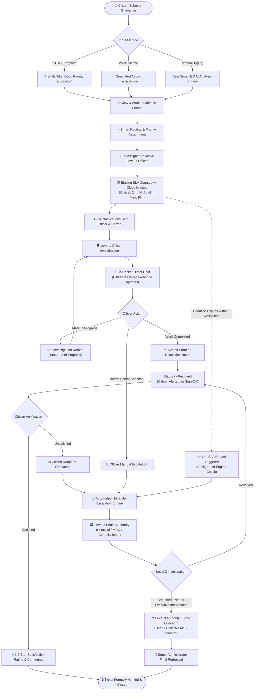
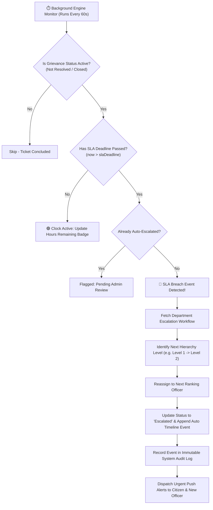
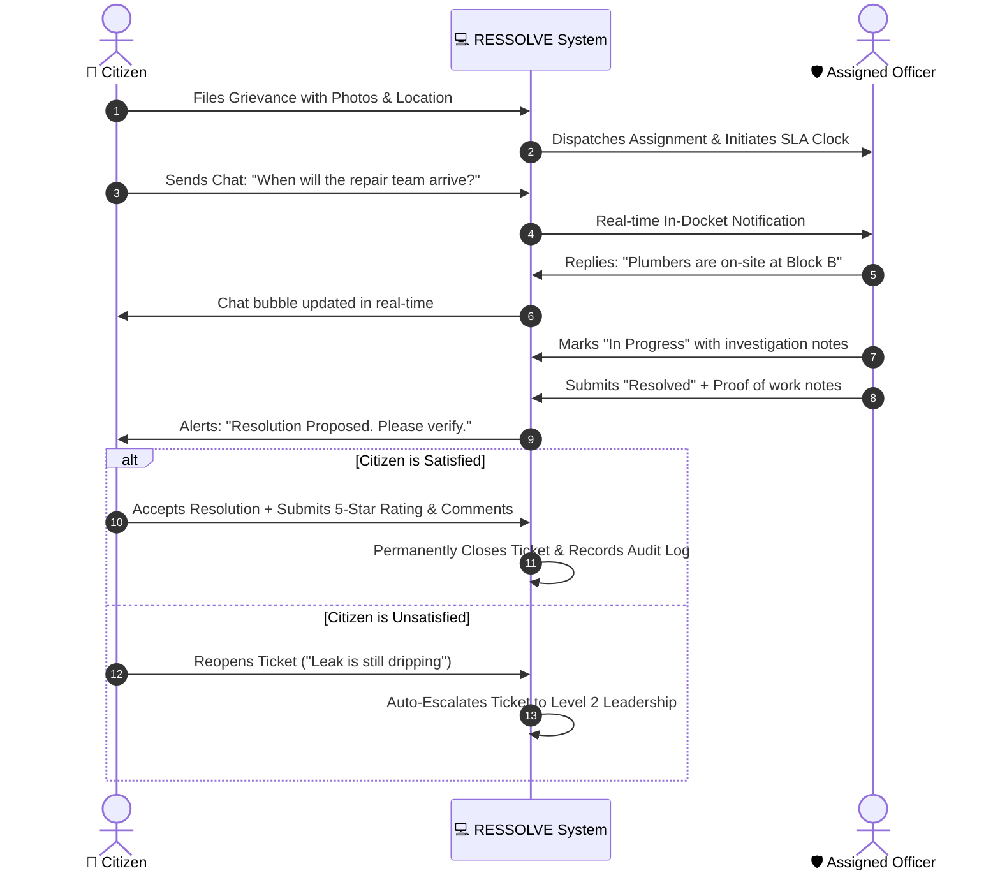

# 🏛️ RESSOLVE — Digital Grievance Redressal & Dynamic Escalation System
## Complete System Functionalities & User Operations Guide

---

## 📌 1. Executive Summary

**RESSOLVE** is a next-generation civic and campus grievance redressal platform engineered for **radical transparency, guaranteed Service Level Agreement (SLA) enforcement, and automated multi-tier authority escalation**.

It bridges the trust gap between citizens/students and administrative bodies by replacing slow, opaque ticketing systems with:
- **Instant AI Smart Routing**: Automatically predicts department and priority SLA.
- **Strict SLA Countdown Clocks**: Binding time limits on every resolution.
- **Automated Authority Escalation**: Unattended issues automatically escalate up the leadership chain.
- **Direct Citizen-Officer In-Docket Chat**: Real-time two-way communication.
- **Citizen Verified Resolution & Rating**: Grievances cannot be closed without citizen sign-off and satisfaction rating.
- **Instant Persona Switcher**: One-click switching between Citizen, Level 1 Officer, Level 2/3 Senior Authority, and Super Admin for evaluation and demonstrations.

---

## 👥 2. User Roles & Access Control (RBAC)

The platform enforces strict Role-Based Access Control across four operational tiers:

```
┌─────────────────────────────────────────────────────────────┐
│                 👑 SUPER ADMINISTRATOR                      │
│     System Configuration, Workflows, Users, Audit Logs      │
└──────────────────────────────┬──────────────────────────────┘
                               │
       ┌───────────────────────┴───────────────────────┐
       ▼                                               ▼
┌──────────────────────────────┐        ┌──────────────────────────────┐
│  🏛️ SENIOR ESCALATION (L2/L3) │        │  🛡️ LEVEL 1 RESPONDERS (L1)  │
│  Principal, MRO, Commissioner│        │  Warden, Inspector, Doctor,  │
│  Collector (IAS), Directors  │        │  VRO, Motor Vehicle Inspector│
└──────────────────────────────┘        └──────────────────────────────┘
                               ▲
                               │ Direct Resolution & Chat
                               ▼
┌─────────────────────────────────────────────────────────────┐
│                 🧑 CITIZENS & STUDENTS                      │
│     Submit Grievances, Track Real-time, Chat & Rate         │
└─────────────────────────────────────────────────────────────┘
```

| Role Persona | Hierarchy Rank | Operational Scope | Available Navigation |
| :--- | :---: | :--- | :--- |
| **Citizen / Student** *(e.g., Bob, Sara)* | Level 0 | Submit grievances, track progress, chat with assigned officers, accept/reopen resolution, rate experience. | Dashboard, Submit Complaint, Track Status, My Profile |
| **Level 1 Officer** *(e.g., Warden Alice, Inspector Carol, Dr. Eve)* | Level 1 | First responder for departmental tickets. Investigate, provide remarks, chat with citizens, submit proof of work, or escalate. | Dashboard, Assigned Tasks, My Profile |
| **Senior Escalation Authority** *(e.g., Principal Henry, MRO Dave, Commissioner Mike)* | Level 2 / 3 | Receives auto-escalated grievances when Level 1 SLA breaches or when manually escalated. Authorized for high-level approvals. | Dashboard, Assigned Tasks, My Profile |
| **Super Administrator** *(e.g., John Admin)* | System Level | Full oversight: Department workflows, SLA threshold rules, user creation/deactivation, system audit logs, and analytics export. | Workflows & SLAs, User Management, Analytics, Audit Logs, Profile |

---

## 🔄 3. End-to-End System Workflows & Escalation Architecture

### 3.1. Complete Grievance Lifecycle Workflow (Step-by-Step Flowchart)



---

### 3.2. Departmental Escalation Chains & SLA Matrix

The system dynamically enforces dedicated escalation workflows for each civic and campus department:

| Department Jurisdiction | Level 1 Responder (L1) | Level 2 Authority (L2) | Level 3 Executive (L3) | Standard SLAs (Crit / High / Med / Low) |
| :--- | :--- | :--- | :--- | :---: |
| **🏨 Hostel & Campus Facilities** | **Warden** (*Alice*) | **Campus Principal** (*Dr. Henry*) | **Dean of Student Affairs** (*Prof. Diana*) | 24h / 48h / 72h / 120h |
| **🏛️ Revenue & Land Admin** | **Village Revenue Officer** (*Victor VRO*) | **Mandal Revenue Officer** (*Dave MRO*) | **District Collector IAS** (*Cathy*) | 48h / 72h / 120h / 168h |
| **🏗️ Municipal & Civil Works** | **Sanitary Inspector** (*Carol*) | **Municipal Commissioner** (*Mike*) | **State Urban Directorate** | 24h / 48h / 96h / 144h |
| **🏥 Public Health & Medical** | **Chief Medical Officer** (*Dr. Eve*) | **State Health Director** (*Dr. Sam*) | **Ministry of Health** | 12h / 24h / 72h / 96h |
| **🚌 Transport & Traffic** | **Motor Vehicle Inspector** (*Frank MVI*) | **Regional Transport Officer** (*Rachel RTO*) | **State Transport Commissioner** | 24h / 48h / 96h / 168h |

---

### 3.3. Automated SLA Escalation Logic Workflow



---

### 3.4. Citizen-Officer Direct Communication & Verification Workflow



---

## ⚡ 4. Feature Breakdown by Module

### 4.1. Instant Persona Switcher (Evaluation Accelerator)
- **Location**: Top navigation header bar (`Switch Persona: [Active User ▼]`).
- **Functionality**:
  - Allows anyone exploring or grading the platform to jump into **any user persona with a single click**.
  - No need to log out, remember passwords, or create dummy accounts.
  - Instantly reconfigures sidebar menus, active ticket queues, and security permissions.
  - Supported Quick Personas:
    - 🧑 **Citizens**: Bob Citizen, Sara Student
    - 🛡️ **Level 1 Responders**: Alice Warden (Hostel), Carol Inspector (Municipal), Dr. Eve (Health), Victor VRO (Revenue), Frank MVI (Transport)
    - ⚖️ **Senior Authorities**: Dr. Henry Principal (Hostel L2), Dave MRO (Revenue L2), Mike Commissioner (Municipal L2), Cathy Collector (IAS Revenue L3)
    - 👑 **Super Admin**: John Admin

---

### 3.2. Citizen Grievance Submission Module
- **Access Route**: `/submit`
- **Features**:
  1. **1-Click Rapid Testing Templates**:
     - Four instant preset chips (*Mess Food Hygiene*, *Brown Tap Water Supply*, *WiFi Backbone Offline*, *Dangerous Road Pothole*).
     - Clicking any chip pre-fills the subject, detailed description, department, priority tier, and location reference.
  2. **Smart Routing NLP AI Assistant**:
     - Listens to keywords in the description in real-time.
     - Displays an interactive AI card showing:
       - Confidence match percentage (e.g., *96% Match*).
       - Detected Department & Category.
       - Recommended Priority SLA with reason.
     - "Apply Suggested Settings" button sets form fields with one click.
  3. **Voice Dictation Simulator**:
     - `🎙️ Speak to Dictate` button simulates audio speech-to-text recording with an active listener state and populates the text field automatically.
  4. **Visual Evidence & Photo Upload**:
     - Attach sample photo evidence or real images with thumbnail previews and one-click removal.
  5. **Location Reference Input**:
     - Specify building, floor, room number, or street landmarks for precise field inspection.
  6. **Formal Tracking Receipt Docket**:
     - Generates a tracking ID (`#GRV-2026-XXXX`).
     - Displays guaranteed redressal SLA countdown and one-click button to jump directly into live tracking.

---

### 3.3. Grievance Tracking, Stepper & Timeline Module
- **Access Route**: `/complaint/:id`
- **Features**:
  1. **5-Stage Visual Progress Stepper**:
     - Step 1: *Grievance Filed* (Timestamped logging)
     - Step 2: *Officer Assigned* (Active responder notified)
     - Step 3: *Under Investigation* (Action in progress or Escalation Level indicator)
     - Step 4: *Resolution Proposed* (Officer submitted proof of repair)
     - Step 5: *Citizen Verified* (5-star satisfaction closed)
  2. **Live SLA Resolution Clock**:
     - Displays time remaining before SLA breach.
     - Dynamic color transitions:
       - 🟢 Green: Safe (> 24 hours left)
       - 🟡 Amber: Approaching deadline (< 24 hours left)
       - 🔴 Red: SLA breached (Auto-escalation triggered)
  3. **Activity Audit Timeline**:
     - Immutable, chronological event log of every status change, remark, officer assignment, and automated escalation.
  4. **Direct Citizen-Officer In-Docket Chat**:
     - Tabbed conversation feed directly on the grievance page.
     - Citizens can ask questions (e.g. *"When will the team arrive?"*).
     - Officers can respond with live updates (e.g. *"Plumber is on-site at Block B"*).
     - Full timestamps and avatar labels for each message.
  5. **Printable Grievance Docket**:
     - `Print Docket` button formats the entire ticket, timeline, and remarks for official printing or PDF export.

---

### 3.4. Officer Action & Resolution Station
- **Access Route**: `/complaint/:id` (when viewed by assigned officer or admin)
- **Features**:
  1. **Investigation Remarks**:
     - Officers must enter official remarks before transitioning ticket statuses.
  2. **Mark In Progress**:
     - Notifies citizen that field work or inspection has commenced.
  3. **Complete & Mark as Resolved**:
     - Opens a formal Resolution Summary modal requiring proof of work (e.g., *"Fiber optic cable spliced; signal verified at 180 Mbps"*).
     - Moves ticket to `Resolved` and notifies the citizen for verification.
  4. **Manual Escalation to Next Authority**:
     - If an issue requires capital expenditure, senior intervention, or cross-departmental coordination, the officer can escalate up the ladder with mandatory justification.

---

### 3.5. Citizen Satisfaction Verification & Reopen Protocol
- **Access Route**: `/complaint/:id` (when grievance is marked `Resolved`)
- **Features**:
  1. **Citizen Verification Banner**:
     - Displays officer's proof of resolution notes.
     - Gives citizen the final authority to sign off on the work.
  2. **Accept & Rate**:
     - Opens an interactive rating modal:
       - 1 to 5 Star Rating picker.
       - Sentiment feedback comments.
     - Changes ticket status to `Closed` and logs the verified rating.
  3. **Reopen / Dissatisfied**:
     - If the issue was not solved properly, the citizen clicks "Reopen".
     - Automatically transitions status to `Escalated` and bumps the ticket to Level 2 authority for formal inquiry.

---

### 3.6. Automated Background SLA Escalation Engine
- **Engine Logic**:
  - Runs continuously in the background.
  - Monitors all active grievances against their `slaDeadline`.
  - If a deadline expires without resolution:
    1. Bumps `escalationLevel` by +1 (e.g. Level 1 Warden $\rightarrow$ Level 2 Principal).
    2. Reassigns the ticket to the higher-ranking authority in the departmental workflow chain.
    3. Changes status to `Escalated`.
    4. Appends an automated audit entry to the timeline: `SLA Threshold Breached! Auto-escalated to Level X`.
    5. Dispatches notifications to both the new senior officer and the citizen.

---

### 3.7. Admin: Workflow & SLA Escalation Builder
- **Access Route**: `/admin/workflows`
- **Features**:
  1. **Department Selection Sidebar**:
     - Switch between *Hostel*, *Revenue*, *Municipal*, *Health*, and *Transport* workflows.
  2. **Visual Escalation Ladder**:
     - Renders the hierarchy sequence (e.g. L1 Warden $\rightarrow$ L2 Principal $\rightarrow$ L3 Dean).
     - **Move Up / Move Down buttons**: Reorder authority tiers effortlessly.
     - **Add Tier**: Add additional supervisory roles.
     - **Remove Tier**: Delete unneeded hierarchy steps.
  3. **Binding SLA Rules Configuration**:
     - Configure permitted resolution hours for each priority tier:
       - 🔴 *Critical SLA* (e.g., 24 hours)
       - 🟠 *High SLA* (e.g., 48 hours)
       - 🟡 *Medium SLA* (e.g., 96 hours)
       - 🟢 *Low SLA* (e.g., 168 hours)
  4. **Reset Defaults Button**:
     - Restores all workflows to standard configuration in one click.

---

### 3.8. Admin: User & Authority Management
- **Access Route**: `/admin/users`
- **Features**:
  1. **Multi-Column Filtering & Search**:
     - Filter users by Department Jurisdiction and Authority Role.
     - Search by name or email.
  2. **Add New Officer / Citizen**:
     - Create accounts with assigned roles, level rankings, department jurisdictions, and contact numbers.
  3. **Edit User**:
     - Modify officer jurisdictions, phone numbers, or role assignments.
  4. **One-Click Deactivate / Reactivate**:
     - Temporarily suspend or restore officer accounts.
  5. **Delete User**:
     - Permanently remove accounts with confirmation dialog.

---

### 3.9. Admin: Analytics & System Reports
- **Access Route**: `/admin/analytics`
- **Features**:
  1. **Executive Metrics**:
     - System SLA Compliance Rate (%)
     - Average Resolution Time (Days)
     - Active Backlog Count
     - SLA Breached Grievance Count
  2. **Visual Recharts Data**:
     - *7-Day Inflow vs Resolution Trend* (Dual Area Chart).
     - *Department Breakdown* (Horizontal Bar Chart).
     - *Overall Status Distribution* (Donut Chart).
  3. **Department Performance Table**:
     - Total grievances, resolution percentages, SLA compliance scores, and average resolution speed per department.
  4. **1-Click CSV Export**:
     - Downloads a formatted CSV summary report for executive reviews.

---

### 3.10. Admin: System Audit Logs
- **Access Route**: `/admin/logs`
- **Features**:
  - Immutable chronological ledger of system activities:
    - Grievance submissions and auto-routings.
    - Status updates and officer remarks.
    - SLA auto-escalation triggers.
    - Workflow modifications and user creations.
  - Filter by Action Type (*Created*, *Updated*, *Escalated*, *Closed*).
  - Search by user name or ticket keyword.
  - Export audit logs to CSV.

---

## 🧭 4. Step-by-Step Walkthrough Guide for Evaluators

### Journey 1: Filing a Grievance as a Citizen
1. Navigate to **http://localhost:5174/**.
2. In the top header bar, click **Switch Persona** $\rightarrow$ select **Bob Citizen**.
3. In the sidebar, click **Submit Complaint**.
4. Click the template chip **"Mess Food Hygiene Issue"**.
5. Observe the **Smart Routing AI card** predict *Hostel & Campus Facilities* with *Critical SLA (24-Hour)*.
6. Click **+ Photo 1** to attach sample visual evidence.
7. Click **Submit Grievance to Portal**.
8. View the generated **Tracking Docket** with Tracking ID (e.g., `#GRV-2026-1001`).
9. Click **Track Grievance Live** to see the 5-step stepper and timeline.

---

### Journey 2: Responding & Chatting as Level 1 Officer
1. In the header bar, click **Switch Persona** $\rightarrow$ select **Alice Warden (Hostel L1)**.
2. You will see the active task queue. Click on the newly submitted hostel grievance.
3. Switch to the **Direct Officer Chat** tab:
   - Type *"Pest control team is inside inspecting the kitchen"* and hit **Send**.
4. In the **Officer Action Station** on the right:
   - Click **Mark as In Progress**.
5. Once ready to resolve:
   - Click **Complete & Mark as Resolved**.
   - Enter proof summary: *"Kitchen deep cleaned and certified safe by campus inspector"*.
   - Click **Confirm Resolution**.

---

### Journey 3: Citizen Verification & 5-Star Rating
1. In the header bar, click **Switch Persona** $\rightarrow$ switch back to **Bob Citizen**.
2. Open the grievance from your dashboard.
3. Observe the green **Resolution Verification Banner**.
4. Click **Accept & Rate**.
5. Select a **5-star rating**, type *"Prompt response and clean mess hall"*, and submit.
6. Notice the ticket permanently transitions to **Closed (Verified)**.

---

### Journey 4: Admin Workflow & Escalation Management
1. In the header bar, click **Switch Persona** $\rightarrow$ select **John Admin**.
2. Navigate to **Workflows & SLAs** in the sidebar.
3. Select **Hostel Grievance Escalation Chain**.
4. Use the **Move Up / Move Down** arrows to modify authority ranks.
5. Edit the **Critical SLA** threshold from `24` to `12` hours.
6. Click **Save Workflow & SLA Rules**.
7. Navigate to **Audit Logs** to verify that your action was recorded in the immutable system ledger.
8. Navigate to **Analytics & Reports** and click **Export Report** to download the CSV.

---

## 🔑 5. Pre-Seeded Accounts Quick Reference

| Account Name | Email | Password | Role | Department |
| :--- | :--- | :--- | :--- | :--- |
| **John Admin** | `admin@system.com` | `Admin@123` | Super Admin | All Systems |
| **Bob Citizen** | `bob@gmail.com` | `Bob@12345` | Citizen | Public |
| **Sara Student** | `sara@gmail.com` | `Sara@1234` | Citizen | Campus |
| **Alice Warden** | `alice@hostel.com` | `Alice@123` | Warden (L1) | Hostel & Campus |
| **Dr. Henry Principal** | `principal@hostel.com`| `Principal@123` | Principal (L2) | Hostel & Campus |
| **Prof. Diana Dean** | `dean@hostel.com` | `Dean@123` | Dean (L3) | Hostel & Campus |
| **Carol Inspector** | `carol@municipal.com` | `Carol@123` | Inspector (L1) | Municipal Infrastructure |
| **Mike Commissioner** | `commissioner@municipal.com`| `Commiss@123` | Commissioner (L2) | Municipal Infrastructure |
| **Victor VRO** | `vro@revenue.com` | `Vro@12345` | VRO (L1) | Revenue & Land |
| **Dave MRO** | `dave@govt.com` | `Dave@1234` | MRO (L2) | Revenue & Land |
| **Cathy Collector (IAS)**| `collector@revenue.com`| `Collect@123` | Collector (L3) | Revenue & Land |
| **Dr. Eve Medical** | `eve@health.com` | `Eve@12345` | Chief Medical (L1) | Public Health |
| **Dr. Sam Director** | `director@health.com` | `Direct@123` | Health Director (L2) | Public Health |
| **Frank MVI** | `frank@transport.com` | `Frank@123` | MVI (L1) | Transport Authority |
| **Rachel RTO** | `rto@transport.com` | `Rto@123456` | RTO (L2) | Transport Authority |

*Note: All demo accounts can also be accessed without entering passwords via the Quick Demo Login buttons on the login screen or via the Persona Switcher.*

---

## 🛡️ 6. Architecture & Reliability Highlights

1. **Dual Storage Engine (Instant & Fault-Tolerant)**:
   - Backed by an instant reactive store in `localStorage` that persists across sessions and tabs.
   - Syncs asynchronously with Firebase Firestore when network and rules permit.
   - **Zero failure rate**: Never locks users out due to expired cloud quotas or permission rejections.
2. **Modern Visual Aesthetics**:
   - Palette tailored for public administration: Precision Blue (`#1677ff`), Imperial Violet (`#722ed1`), Sunset Rose (`#ff4d4f`), and Emerald Green (`#52c41a`).
   - Clean dark and light mode support with glassmorphism touches.
   - Standardized typography using Google Font `Plus Jakarta Sans`.
3. **Mobile & Desktop Responsive**:
   - Collapsible desktop sidebar and sliding drawer overlay for mobile and tablet screens.
